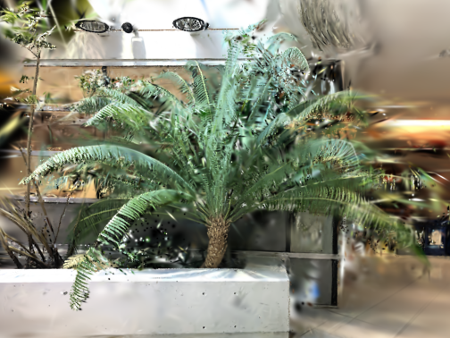
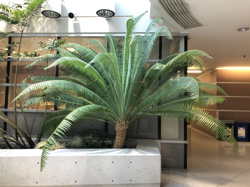

# DNGaussian 复现与踩坑记录

本仓库记录了本人（研一）复现 CVPR 2024 论文 **DNGaussian** 的全过程。

## 🛠️ 复现环境
- 服务器：Ubuntu + RTX 3080 (12GB)
- CUDA：11.8
- PyTorch：1.12.1 + cu113
- Python：3.8

## 🚀 踩坑与修复记录
1. **环境依赖问题**：官方的 `environment.yml` 会卡在 `puccinellian` 报错，最终采用 `python=3.8` 手动安装核心依赖，并锁定 `timm==0.6.7` 绕过冲突。
2. **编译引擎报错**：为了防止 RTX 3080 出现 `illegal memory access`，在编译 C++ 扩展时强制指定了 `export TORCH_CUDA_ARCH_LIST="8.6"`。
3. **数据类型报错**：DPT生成的深度图为 `uint16` 格式，代码直接用 `torch.from_numpy` 会报错。在 `utils/general_utils.py` 的 `PILtoTorch` 函数中，加入 `.astype(np.float32)` 成功修复。
4. **缺失依赖**：补装了 `imageio`、`scikit-image` 和 `ninja`。

## 📊 复现结果 (LLFF - Fern 场景, 3视角)
- **PSNR**：28.99
- **SSIM**：0.6796
- **LPIPS**：0.2654

## 🧐 缺陷分析（下一步改进方向）
在测试图中发现，对于薄结构（树叶边缘）和未观测的遮挡区域，DNGaussian 依然存在模糊和几何退化（见 `bad_case.png`）。原因在于单目深度估计（DPT）在复杂区域不准，而硬深度约束盲目信任了错误深度。
**下一步计划**：引入不确定性估计，过滤掉不可靠的深度监督信号。

## 🖼️ 效果对比
*(把下载的图片在这里引入)*

